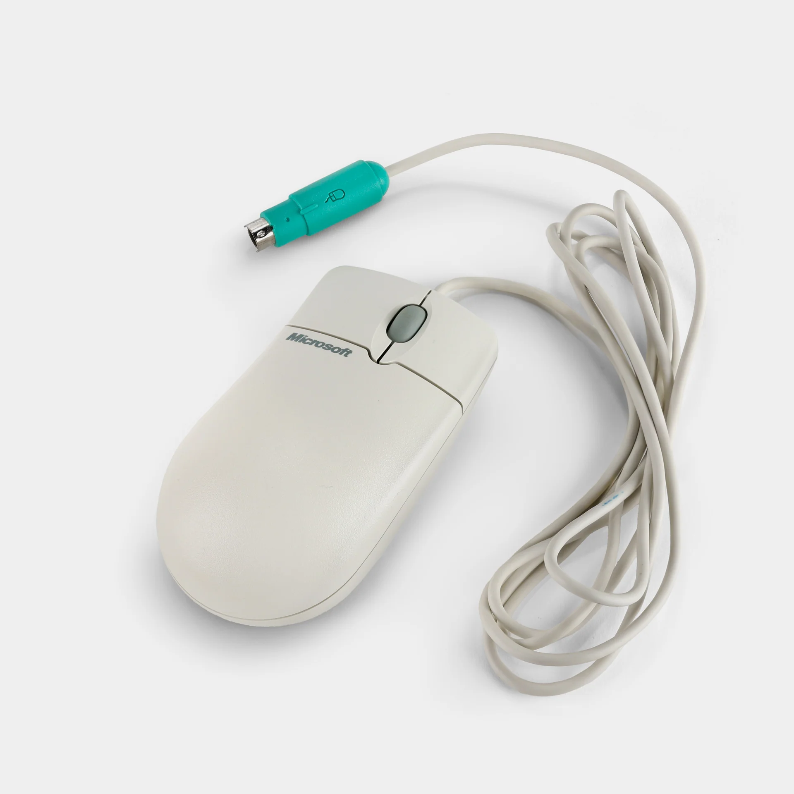

A very impactful aspect of my personal life was my opportunity to see someone up close go through a radical, positive mental change. It made it very clear that positive change can be made through simple repeated mechanics.

Until I was about thirteen years old, my dad was very prone to anger. Generally known as a "mean" person. Lots of outbursts.

# Killing Three Mice

The most visible manifestation of my dad's anger would show up at the office. He would get frustrated debugging Visual Fox Pro, and smash his keyboard or mouse until it exploded.

It happened often, so on the right side of his desk he kept 3-5 replacements of each so he could immediately replace the broken device and continue.

_Undoubtedly quite satisfying to smash._

On July 7th, 2006, he smashed one mouse in the morning. A second shortly after. Made it to the afternoon, and obliterated a third mouse. Untenable.

To get his anger under control, he set a goal of:

1. Hitting $XX net profit two months in a row.
2. Go at least 30 days in a row without ever being frustrated, angry, or overwhelmed.

If he hit those goals, then he could buy a new car.

After 5 months he hit the first goal, but never the second. After 12 months of not hitting his happiness goal, he asked my sister for help.

# Living in the Light
For my dad, being happy is called "living in the light". I'm not sure why he calls it that. Possibly to give you more latitude in the interpretation of your current state.

He asked my sister to call him _every hour of every day from 8AM to 5PM_ and ask "Dad, are you living in the light?". 10 calls a day. He had to pick up each call, and of course answer honestly. Anything but a firm "yes" restarted the 30 day timer.

It worked. After 2.5 months he made it 30 days. Since that point in time he still is consistently the happiest person I have ever met.

# Practical Applications

Beyond the obvious immediate impact for personal happiness, I think there are a few interesting takeaways:

1. Lack of success over 12 months.
2. Impact of answering to someone who's opinion you value.
3. Effectiveness of repetition.
4. Permanency once the habit is set.
5. Change in mental state as a "choice".

Each of these is applicable for yourself. But more immediately, it can be helpful to think about each of these in context of working relationships.

### The First 12 Months 

His experience of pursuing an inner goal in earnest failing without external checks is consistent with what I see in my and other's lives. 

When attempting to drive change within yourself, in teammates or an organization, there needs to be a quantitative or qualitative measurement of that goal. A lossy indicator (he could've lied on those calls!) is still significantly better than a goal without a check.

### Accountability Partner

My sister played the role of an accountability partner. That partner can be a person. It can also be a market, product or service. Whatever it takes to avoid the error in #1.

For hard to change behaviors, an individual who you don't want to let down is the most effective. More practically, you can be that person for teammates whose behavior you want to change.

I've wrote about it in a very short three part series when I needed that. [One](https://huntermonk.com/2018/04/29/30-day-challenge.html), [two](https://huntermonk.com/2018/05/13/30-day-challenge-update.html), and [three](https://huntermonk.com/2018/05/31/30-day-challenge-complete.html).

### Repetition
What an incredibly simple task! It was a <3 second phone call. It did not require high levels of introspection. We are simpler than the dogs in [Skinner's Box](https://en.wikipedia.org/wiki/Operant_conditioning_chamber)!

In the future, I would like to write about how humans, consistently throughout time, believe we are more important and complex than we really are. A post for another time.

For now, this is a great illustration that driving changes in human behavior is very simple. It just takes more consistency than you expect.

### Permanency

I am surprised at how consistent the behavior change has been. I have never seen him slip back into anger at any point in my life since then.

To be frank, I don't understand why that is. It could be that before the pain was so great, and the reward is so strong, that reverting back is unthinkable. If that's the case, it may not be applicable in a wide range of scenarios. Only drastically bad ones.

Rather than speculate as belief, I will simply say I do not know why this change became so permanent.

### Mental Malleability

The most important takeaway is illustrating how malleable our internal state is. He was 54 on the day of the mouse genocide. He had lived an angry life with fervor every year until then.

With repetition and accountability, our internal and external close (can't change if not frequent contact) relationships can be concretely and permanently changed.

It was a gift to see this radical alteration up close. 
